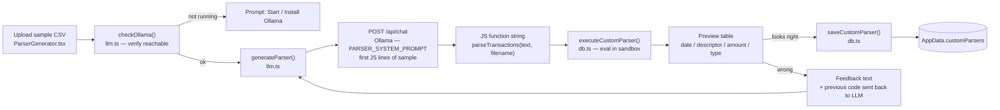
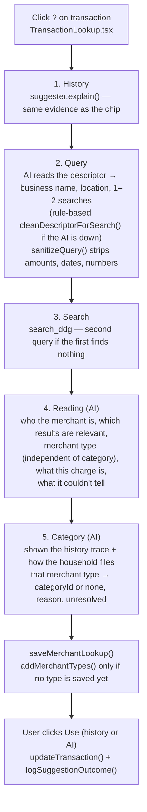
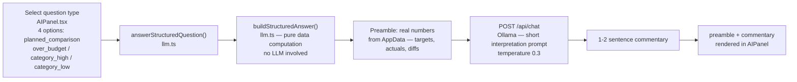

# AI features

All AI features call a local [Ollama](https://ollama.com) instance over HTTP. No data leaves the machine. The default model is `qwen2.5:7b`; this is configurable in Settings → AI.

**Required setup:** Ollama running at `http://localhost:11434` (default) with a model pulled. The app can install and start Ollama on Linux directly from Settings or the parser generator UI.

---

## 1. Custom parser generation

User uploads a sample CSV → LLM writes a `parseTransactions(text, filename)` JavaScript function → the app evals it in-memory → user previews results → save or retry with feedback.

**Key detail:** if the generated parser returns 0 results on the real file but works on the sample, the app auto-detects this and offers "Fix with feedback" rather than silently failing. The retry path sends the original sample, the broken code, and the user's description of the problem to the LLM together.

---

## 2. Transaction lookup (`?`)

User clicks `?` on a transaction → `runLookup()` (`logic/lookup.ts`) works through five steps, each recording a status (`done` / `skipped` / `failed`) and a note, so the window shows where it stopped and why. It only **recommends**: nothing changes a transaction until the user clicks a Use button. The finished report is saved per merchant (`AppData.merchantLookups`); with no history guess, its category shows as that merchant's dashed `✦` suggestion chip.

Skips: bank transfers have no merchant (all AI/search steps skipped); Amazon products skip the search (the title says what it is). Model calls use Ollama's `format` JSON schema (`ollamaJson()` in `llm.ts`), so replies are parsed, not regex-scraped. The pipeline takes its model/search calls as arguments, so `lookup.test.ts` runs it without Ollama.

The `ⓘ` button on an uncategorized row opens `SuggestionDetails.tsx`: the chip's full reasoning, including why it made no guess. It is local only (no AI, no search).

---

## 3. Structured budget questions (AIPanel)

The AI button opens `AIPanel.tsx`, which presents four pre-defined question types. The app builds the full data answer itself (`buildStructuredAnswer()`) and asks the LLM only for a 1–2 sentence interpretation. This makes answers accurate even with small models.

**Four question types:**
- `planned_comparison` — compares budget targets between two months (requires `monthA`, `monthB`)
- `over_budget` — lists categories that exceeded their target in a given month
- `category_high` — shows all transactions for a category in a month, largest first
- `category_low` — shows a category's transactions vs the prior 3 months; identifies missing descriptors

**Key detail:** `sendChat()` is defined in `llm.ts` (full tool-calling chat loop with all six tools) but is not called by any component in the current codebase. `AIPanel.tsx` uses only `answerStructuredQuestion()`.

---

## Files involved

| File | Role |
|---|---|
| `src/logic/llm.ts` | `generateParser()`, `ollamaJson()`, `searchWeb()`, `answerStructuredQuestion()`, `buildStructuredAnswer()`, `checkOllama()`, `cleanDescriptorForSearch()`, `sendChat()` (unused) |
| `src/logic/lookup.ts` | `runLookup()` — the five-step `?` pipeline; `sanitizeQuery()` |
| `src/components/ParserGenerator.tsx` | Parser generation UI — 4-step flow: create → preview → confirm → wrong |
| `src/components/TransactionLookup.tsx` | `?` window — runs or reopens the saved lookup, shows each step, Use buttons, merchant-type picker |
| `src/components/SuggestionDetails.tsx` | `ⓘ` window and `HistoryEvidence` — the chip's reasoning |
| `src/components/AIPanel.tsx` | Structured question panel — renders 4 question-type buttons, calls `answerStructuredQuestion()` |
| `src/db.ts` | `executeCustomParser()`, `saveCustomParser()`, `updateTransaction()`, `getAISettings()` |
| `src-tauri/src/lib.rs` | `search_ddg` (DuckDuckGo), `find_ollama`, `install_ollama`, `start_ollama` |
