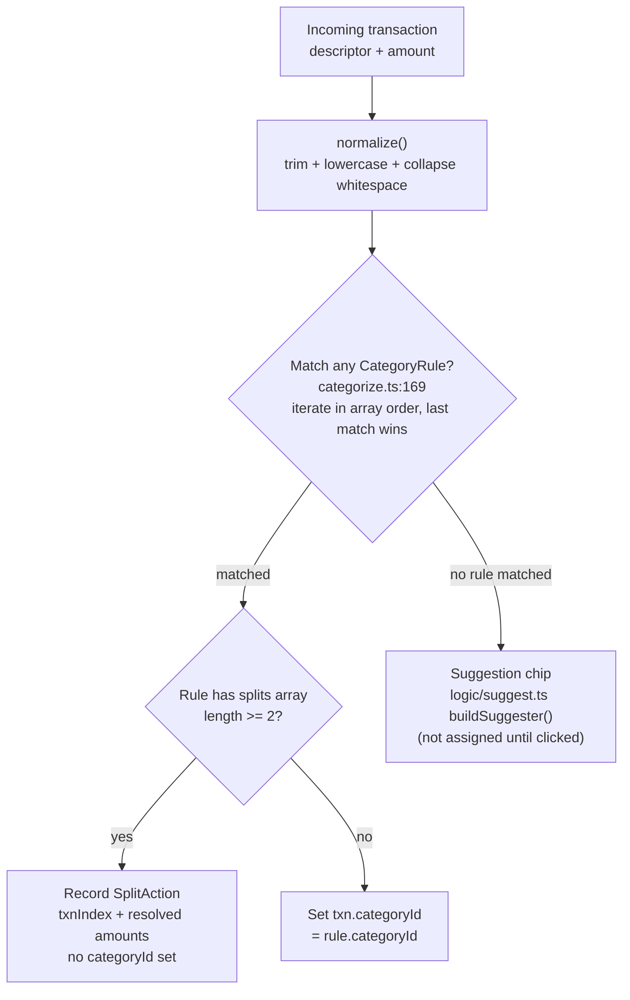

# Categorization flow

There are two distinct categorization mechanisms. **Rule-based assignment** runs at import time inside `categorizeTransactionsInPlace()` and assigns a `categoryId` (or records a split action) before transactions are persisted. **Suggestion scoring** (`logic/suggest.ts`) runs for transactions that didn't match any rule — see the `kestl-data-flows` skill for how it works.

## Decision flow

## Rule matching details

Rules are stored in `AppData.categoryRules` and iterated in array order. **Last match wins** — a rule at the end of the list overrides earlier ones. There is no automatic sorting by length or specificity; ordering is fully user-controlled.

`matchType: 'exact'` — `normalize(rule.pattern) === normalize(txn.descriptor)`
`matchType: 'contains'` — `normalize(txn.descriptor).includes(normalize(rule.pattern))`

Optional `amountMatch` — must be within `$0.01` of `txn.amount`.

## Scoring details

See the `kestl-data-flows` skill (category suggestion scoring).

## Files involved

| File | Role |
|---|---|
| `src/logic/categorize.ts` | All categorization logic: `categorizeTransactionsInPlace`, `runRuleOnHistory`, `createRuleAndApply` |
| `src/db.ts` | Stores `categoryRules` and `transactions`; `getData()` is called to read both |
| `src/components/ImportView.tsx` | Calls `categorizeTransactionsInPlace()` before inserting transactions |
| `src/logic/suggest.ts` | Merchant parsing and history-based suggestions |
| `src/logic/aiSuggest.ts` | Local-model merchant labels (kind of business) used as a fallback tier |
| `src/components/TransactionView.tsx` | Builds the suggester and renders suggestion chips on uncategorized rows |
| `src/components/SettingsView.tsx` | Calls `runRuleOnHistory()` when user applies a rule retroactively |
