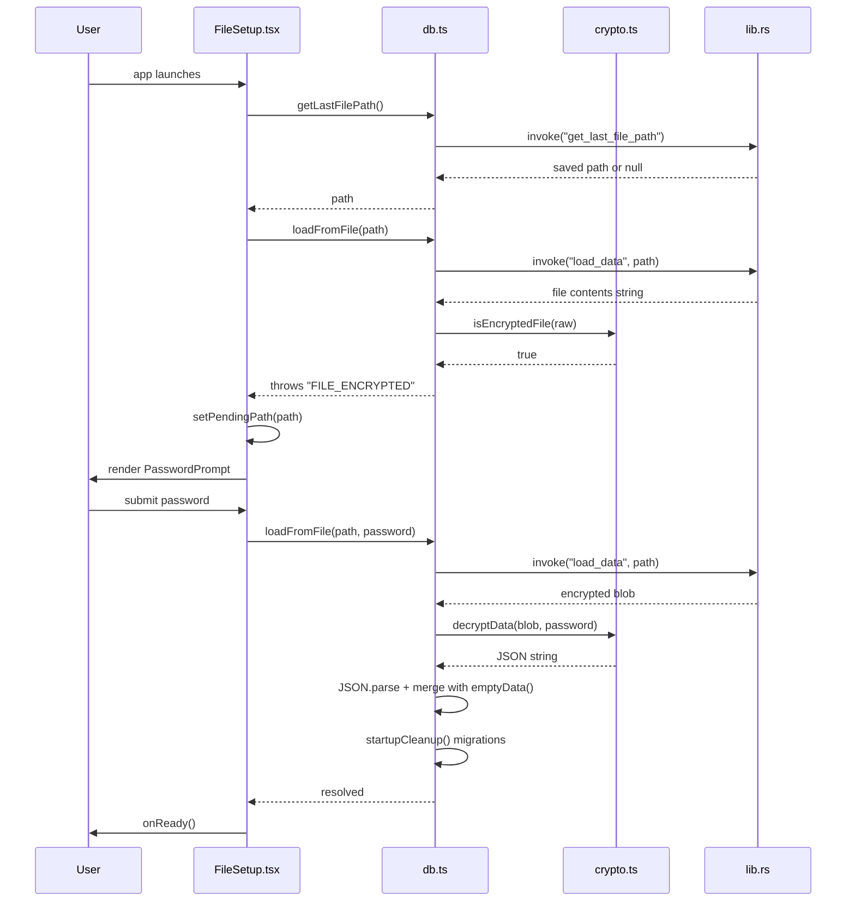
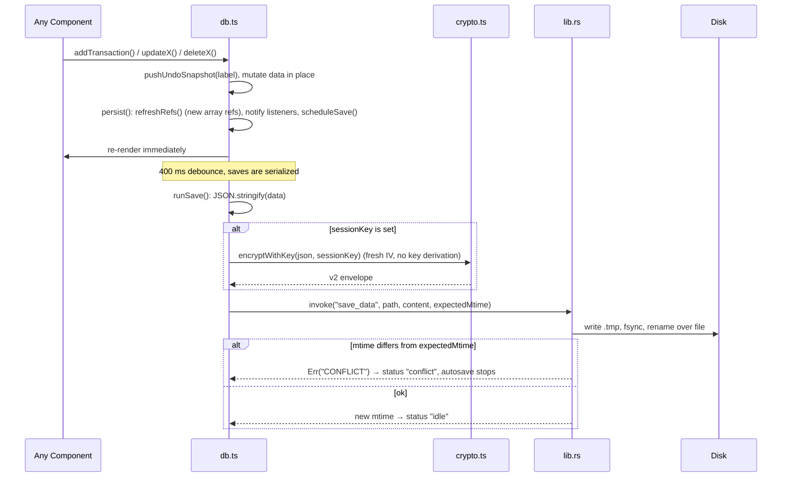

# Save / load flow

The budget is a single `.json` file on disk. When encryption is enabled the file is an AES-256-GCM envelope; otherwise it is plain JSON. The Rust backend handles all filesystem access; the frontend never calls Node or browser file APIs directly.

## Opening an encrypted file



## Saving (every mutation)

Saving is decoupled from mutating: the UI updates immediately and the disk write is debounced (400 ms), atomic, and conflict-checked.



`flushSave()` forces the pending write (used before switching files, backups and on window close). Errors retry at 2 s, 5 s, 15 s and then stay in `error` until the user presses Retry. On `conflict`, the UI asks the user to reload from disk or overwrite (`resolveConflict`).

## Encrypted file format

Plain JSON files are human-readable. Encrypted files are a JSON object:

```json
{
  "budgetEncV1": 2,
  "kdf": "PBKDF2-SHA256",
  "iterations": 600000,
  "salt": "<base64, 16 bytes>",
  "iv": "<base64, 12 bytes>",
  "data": "<base64 AES-GCM ciphertext>"
}
```

`isEncryptedFile()` detects the format by checking for the `"budgetEncV1"` marker string. Version 1 files (100,000 iterations, no `iterations` field) still load and are upgraded to v2 on the first save.

## Crypto details

All cryptography is in `src/utils/crypto.ts` using the Web Crypto API (`crypto.subtle`):

- **Cipher:** AES-256-GCM
- **Key derivation:** PBKDF2-SHA256, 600,000 iterations, 16-byte random salt; derived **once per session** (`createSessionKey`) and reused for every save
- **IV:** 12-byte random, generated fresh on every `encryptWithKey()` call
- **Wrong password:** AES-GCM authentication fails and `decryptData()` throws `"Wrong password or corrupted file"`

`sessionPassword` and `sessionKey` are kept in module-level variables inside `db.ts` and are never written to disk.

## Startup jobs

After a file is loaded (app start, or switching files in Settings), `runStartupJobs()` (`src/startup.ts`) runs in order: `startupCleanup()`, `processRecurringTemplates()`, `processSchedules()`, `flushSave()`, `runBackup('startup')`. `startupCleanup()` returns the list of `{ id, changed }` it applied; destructive fixes are one-time migrations keyed by string ID in `AppData.completedMigrations`.

## Backups

`src/backup.ts` copies the *saved* file (so encrypted files give encrypted backups) via the `backup_file` command into `<data dir>/kestl-backups` (folder is per machine and per file; enabled/count live in `AppData.backupSettings`). Runs at startup, every 30 minutes if a save happened, and before imports, merges and purges.

## Files involved

| File | Role |
|---|---|
| `src/components/FileSetup.tsx` | First-run UI — opens last file automatically, shows open/create/template buttons |
| `src/components/PasswordPrompt.tsx` | Password entry screen rendered when `loadFromFile()` throws `FILE_ENCRYPTED` |
| `src/utils/crypto.ts` | `createSessionKey()`, `encryptWithKey()`, `decryptWithPassword()`, `isEncryptedFile()` |
| `src/db.ts` | `loadFromFile()`, `persist()`, `createNewFile()`, `createDemoFile()`, `enableEncryption()` |
| `src/startup.ts`, `src/backup.ts` | Startup job sequence; backups |
| `src-tauri/src/lib.rs` | `load_data`, `save_data` (atomic, conflict-checked), `file_mtime`, `backup_file`, `get_last_file_path`, `set_file_path` Tauri commands |
